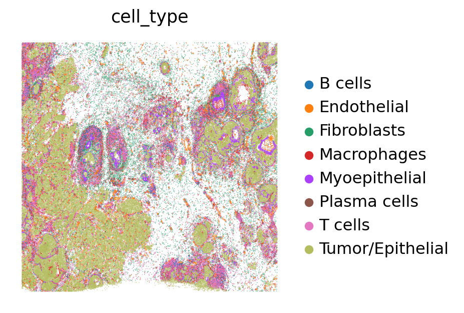
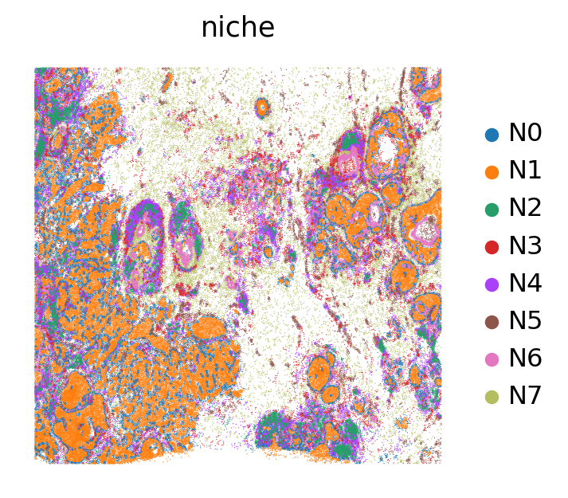
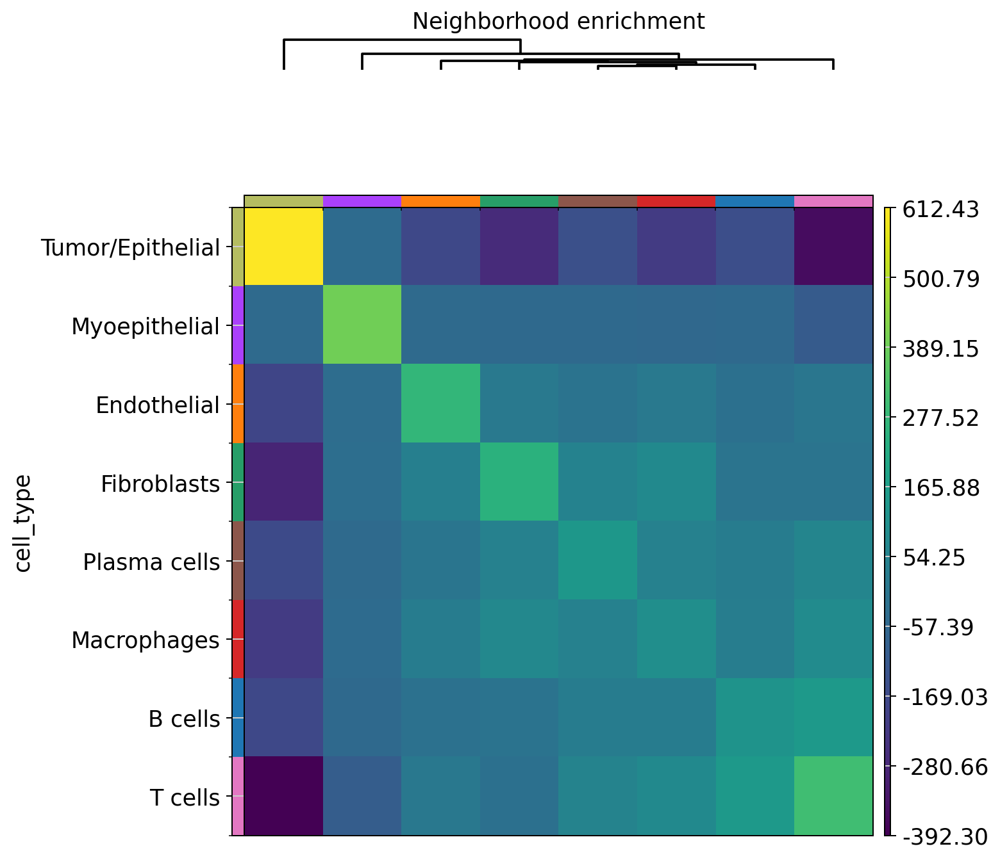
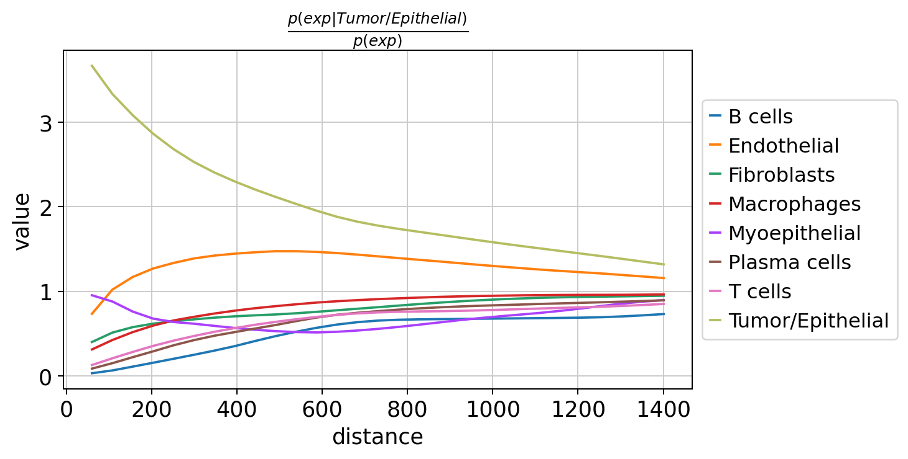
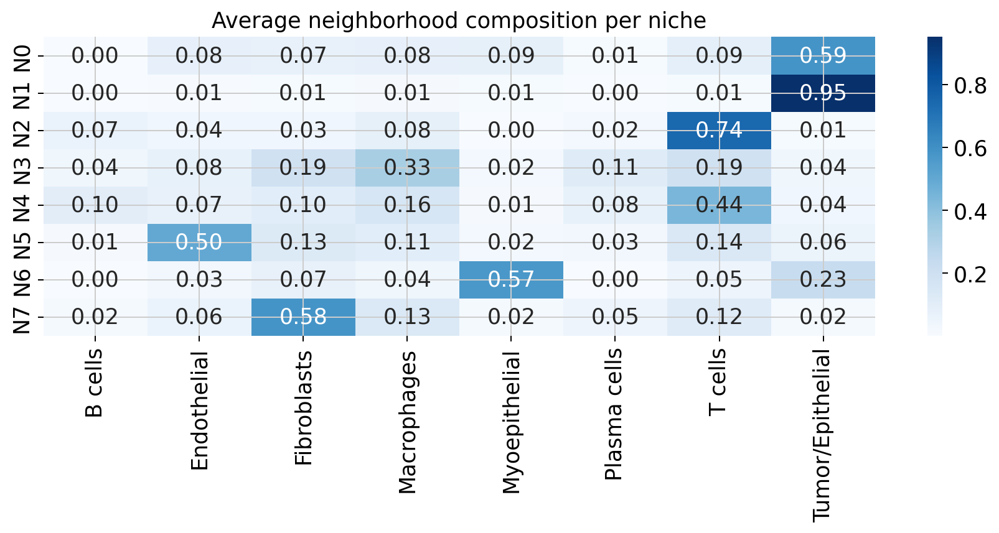

# Tumor–Immune Niches in Breast Cancer
### Single-cell spatial transcriptomics analysis of a 10x Xenium tissue section

    

[](https://colab.research.google.com/github/ZerihunWaje/spatial-tumor-immune-niches/blob/main/notebooks/spatial_tumor_immune_niches.ipynb)

This project maps where tumor, immune and stromal cells sit in a breast cancer tissue section, measures which cell types are neighbors and which avoid each other, and defines recurring local microenvironments (niches).

<p align="center">
  
  
</p>

## Key findings

- **Immune-excluded tumor.** T cells, B cells and plasma cells are almost absent within ~100 µm of tumor cells. Tumor–T cell is the strongest avoidance in the tissue (neighborhood enrichment z ≈ –375). Immune cells stay in the surrounding stroma.
- **Organized immune compartments.** T and B cells co-localize (z ≈ 148) in lymphoid aggregates. Macrophages pair with fibroblasts and T cells in a myeloid-rich stroma.
- **Eight spatial niches:** tumor core, tumor border, DCIS-like duct wall, T-cell zone, lymphoid aggregate, myeloid-rich stroma, fibroblast stroma and vascular niche.
- **Spillover check.** Tumor cells with many immune neighbors appeared to express macrophage and fibroblast genes (CD68, LYZ, POSTN, LUM). This is segmentation spillover from neighboring cells, not tumor biology. LDHB and PDK4 remain candidate tumor-intrinsic changes.
- **Spatially variable genes.** Epithelial genes (KRT7, EPCAM, FASN, FOXA1) and stromal genes (LUM, POSTN, CXCL12) have the strongest spatial structure (Moran's I up to 0.67).

## Dataset

| | |
|---|---|
| Sample | Xenium FFPE Human Breast Cancer, In Situ Replicate 1 |
| Source | 10x Genomics; Janesick et al., *Nature Communications* 2023 |
| Technology | Xenium In Situ (imaging-based, single-cell resolution) |
| Size | 167,780 cells (165,423 after QC), 313-gene panel |
| License | CC BY 4.0 |

Raw data is not stored here. The notebook downloads it; see [`data/README.md`](data/README.md).

## Questions

1. Which cell types make up the tumor and its microenvironment?
2. Which cell types are spatially enriched next to each other, and which avoid each other?
3. Which genes show strong spatial patterns?
4. What recurring niches exist?
5. Do tumor cells with immune neighbors differ from tumor cells without?
6. Which ligand–receptor pairs could connect tumor and immune cells?

## Workflow

```
Download (2 files from the Xenium bundle)
   ↓
Load counts + cell coordinates → AnnData
   ↓
QC → normalize → log → PCA → UMAP → Leiden clustering
   ↓
Cell type annotation (marker scores + manual check)
   ↓
Spatial graph (10 nearest neighbors)
   ├── Neighborhood enrichment (permutation test)
   ├── Co-occurrence across distance
   ├── Spatially variable genes (Moran's I)
   └── Niche detection (neighbor composition → k-means)
            ↓
   Tumor cells: immune-rich vs immune-poor (Wilcoxon, BH)
            ↓
   Ligand–receptor analysis (OmniPath)
```

Full details: [`docs/methods.md`](docs/methods.md)

## Results

**Cell types:** tumor/epithelial 41% · T cells 19% · fibroblasts 12% · macrophages 10% · endothelial 8% · myoepithelial 5% · plasma 3% · B cells 3%

| Neighborhood enrichment | Co-occurrence with tumor cells |
|---|---|
|  |  |

| Niche | Main composition |
|---|---|
| Tumor core | 95% tumor |
| Tumor border | 59% tumor + mixed stroma and immune |
| Duct wall (DCIS-like) | 57% myoepithelial + 23% tumor |
| T-cell zone | 74% T cells |
| Lymphoid aggregate | T cells, macrophages, B and plasma cells |
| Myeloid-rich immune stroma | 33% macrophages + fibroblasts, T cells |
| Fibroblast stroma | 58% fibroblasts |
| Vascular niche | 50% endothelial |



All figures are in [`results/figures/`](results/figures/) and tables in [`results/tables/`](results/tables/).

## Repository structure

```
spatial-tumor-immune-niches/
├── README.md
├── LICENSE
├── requirements.txt
├── .gitignore
├── notebooks/
│   └── spatial_tumor_immune_niches.ipynb   # full analysis with outputs
├── data/
│   └── README.md                           # how to get the data
├── docs/
│   └── methods.md                          # methods in detail
└── results/
    ├── figures/                            # 18 figures, numbered in analysis order
    └── tables/                             # cell counts, enrichment z-scores, niches, top SVGs
```

## How to run

**Google Colab (recommended):** click the "Open in Colab" badge above, then Runtime → Run all. After the install cell, restart the session once (Runtime → Restart session) and run from the second cell.

**Locally:**
```bash
git clone https://github.com/ZerihunWaje/spatial-tumor-immune-niches.git
cd spatial-tumor-immune-niches
pip install -r requirements.txt
jupyter notebook notebooks/spatial_tumor_immune_niches.ipynb
```

## Limitations

- One tissue section and no clinical contrast (e.g. pre/post treatment, primary vs metastasis)
- 313-gene panel, so annotation is broad (no CD4 vs CD8 T cell subtypes) and ligand–receptor coverage is limited
- Marker-based annotation instead of reference-based label transfer
- Segmentation spillover affects cells at tissue borders

## Next steps

- Replicate 2 of the same tissue to check reproducibility
- Spillover-aware differential expression or re-segmentation
- Label transfer from the matched single-cell (scFFPE-seq) data
- Integrate the post-Xenium immunofluorescence and H&E images
- Apply the pipeline to cohorts with treatment or metastasis contrasts

## Data citation

Janesick, A. et al. High resolution mapping of the tumor microenvironment using integrated single-cell, spatial and in situ analysis. *Nature Communications* 14, 8353 (2023). Data © 10x Genomics, CC BY 4.0.

## Author

**Zerihun Waje** · [LinkedIn](https://www.linkedin.com/in/waje) · [GitHub](https://github.com/ZerihunWaje)

Code: MIT License. Data: 10x Genomics, CC BY 4.0.
